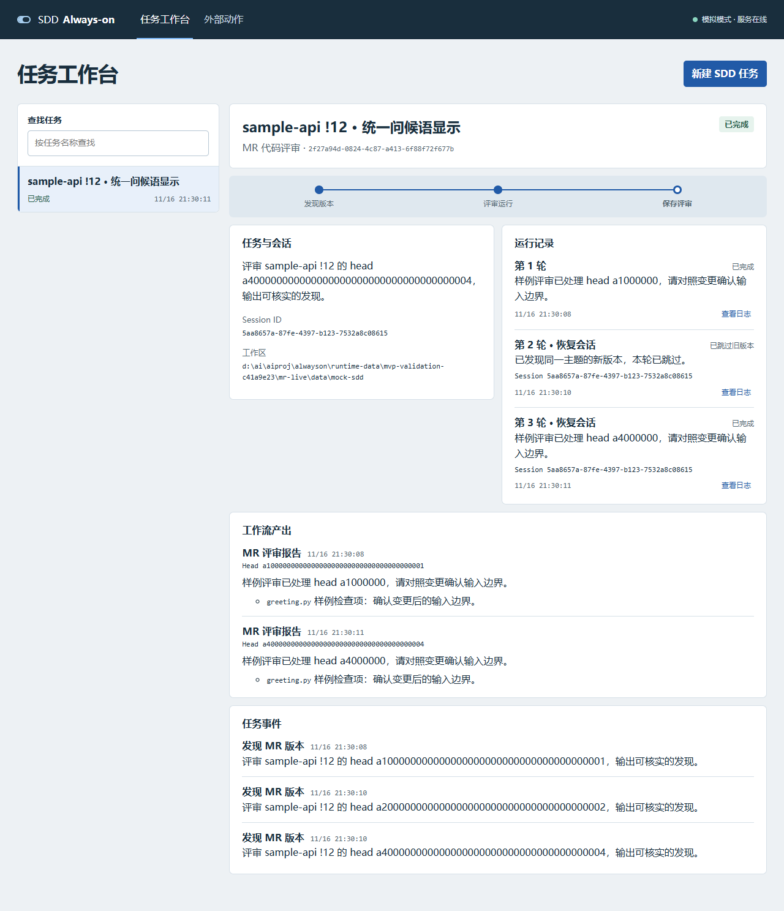
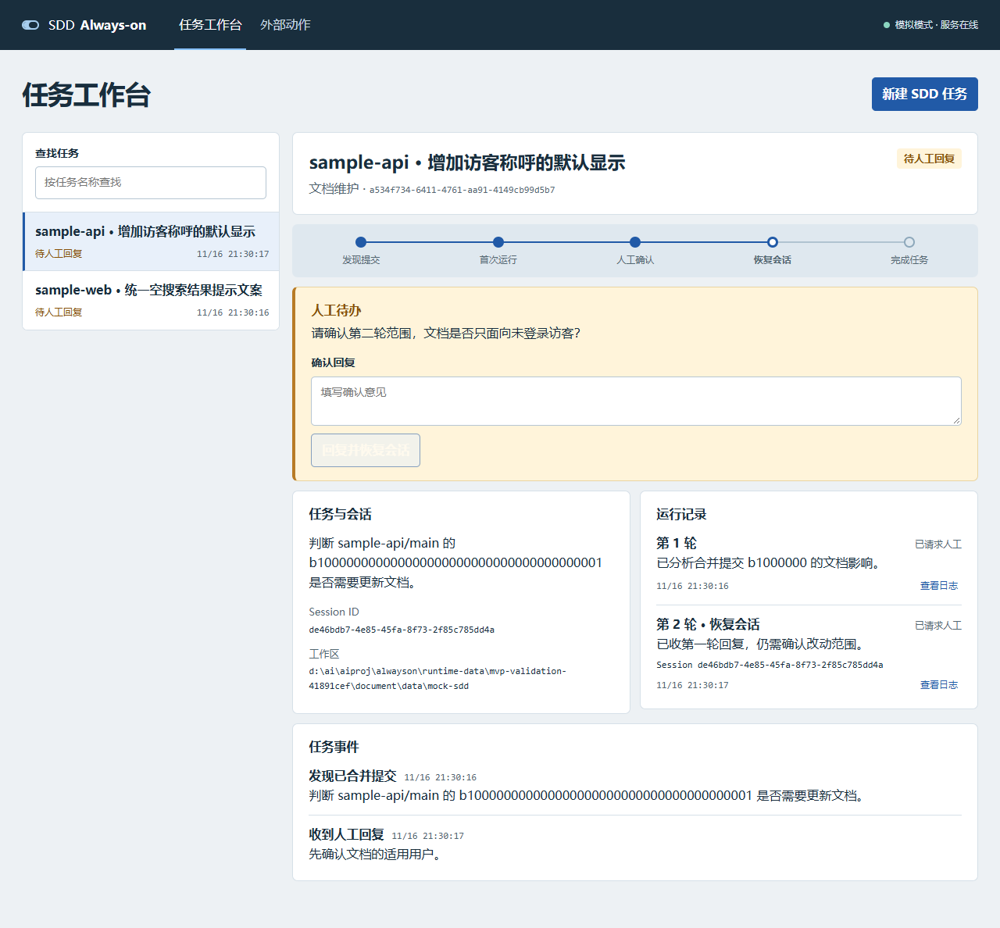
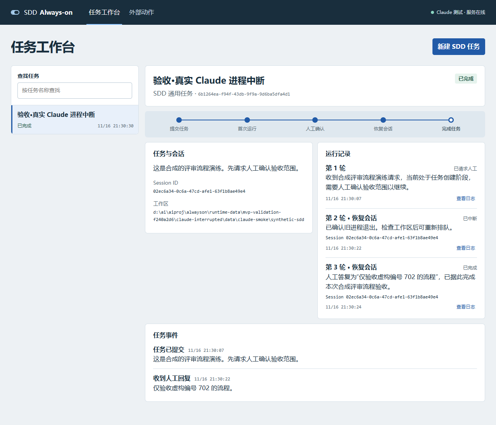

# Always-on MVP 场景验收与稳定性报告

验收日期为 2026-11-16。使用 Windows、Edge、独立运行目录和真实 Uvicorn 进程。合成 Git、通知和日志数据用于故障复现，任务状态、SQLite、调度、Runner、Outbox 和 Vue 管理台均走实际实现。关键 Resume 另用 Claude Code `2.1.109` 和硅基流动 Kimi 验证。

**结论：具备进入公司内网隔离测试环境联调的条件。** P0 未发现，本轮发现的一项 P1 已修复并复测。完整 MVP 操作验收仍有缺口，生产启用须单独验收。

P3.5 已复验会话中心、工作流管理和任务关闭。下方场景表保留原 P1～P3 验收结果，本次管理功能的最新状态见 [P3.5 管理功能复验](#p35-管理功能复验)。

## 场景结果

| 场景 | 方法 | 预期 | 实际与状态 |
| --- | --- | --- | --- |
| 1. 多个 SDD Task 交错 | 网页连续创建三项，等三项均挂起，重启后按乙、丙、甲回复 | 每项恢复自己的 Session，回复与运行归属一致 | **通过。** 三个独立 Session，各两轮，输入和日志归属正确。Dispatcher 按设计串行领取。 |
| 2. MR 连续推送 | 同一 MR 已处理首个 SHA，长时间占用第二次评审，其间连续推送两个新 SHA 并重放。分别正常完成旧进程和强制重启后恢复 | 只发布有效版本，旧结果和旧 Wakeup 被挡住，新版本复用 Session | **通过，修复后。** 两条路径均只留下首个和最新 SHA 的报告与各一条评论。正常结束的旧 Run 标为已跳过，中断路径只执行最新 SHA。 |
| 3. 文档两轮澄清 | 多仓增量创建任务，合成 Agent 提出两次问题，第二次回复前重启服务 | 保留原等待状态、两次回复与 Session，最后提交同一 Commit 的建议 | **通过。** 浏览器回复两次，共三轮，同一 Session。建议包含第二次回复，另一个仓库的待办仍在等待。 |
| 4a. Claude 执行中断 | 真实 CLI 正在恢复时暂停其进程，终止并重启服务。从页面读原因、停止旧进程和重排 | 存活旧进程阻止补跑。停止后只恢复一次原 Session | **通过。** 旧进程存活时重试返回 409。页面停止后，真实 CLI 第三轮使用原 Session 完成，并引用人工回复的合成编号。 |
| 4b. Wakeup 领取后中断 | 在持久化领取后、启动 Agent 前终止服务，再从页面重排 | 旧领取记录可追溯，实际只启动一次 | **通过。** 页面显示「进程登记前中断」。重排后只启动一个新进程，后续回复可正常继续。 |
| 4c. Outbox 结果未知 | Mock 远端已持久化评论，本地仍在 `sending` 时终止服务。分别模拟远端可核对和返回未知 | 自动核对或转人工，保留原远端 ID，禁止盲发 | **通过。** 自动核对与页面人工核对都保留唯一评论和原 ID。两条路径的发送尝试次数都为 1。 |
| 5. 多仓增量与部分失败 | 已入库两仓后投递单仓增量，让另一仓 Connector 报错。重启、解除故障、补扫和重扫 | 失败时保持两仓游标和任务数，补扫只入库新增项 | **通过，故障提示有缺口。** 失败保持游标 `1/2`，补扫仅将变更仓推进至 `3` 并增加一个任务，重复扫描为零。失败响应仅为通用 HTTP 500。 |
| 6. Workflow / Skill 配置 | 等待澄清时改 YAML 的 Skill 版本后重启。分别试无效 YAML、缺 Connector、缺 Profile 和不存在的 Skill ID。通过移出、恢复 YAML 验证启停 | 在途任务使用原快照，新任务使用新配置。无效配置或缺依赖时应明确报错，恢复配置后可继续 | **部分通过。** 在途使用 `v1`，新任务使用 `v2-qa`。错误 YAML、Connector 和 Profile 均拒绝启动。移出 YAML 后停止扫描，恢复后补扫。**真实 Skill 依赖因内网条件未验证。** Mock 接受任意有效格式的 Skill ID。 |
| 7. 预约、关闭和反馈竞态 | 并行提交两条不同回复，同时发起文档扫描，探测任务关闭和 Agent 指定时间唤醒入口 | 回复至多接受一次，各类同时到达的事件按任务状态裁决 | **部分通过。** 一条回复成功，另一条返回 409，重放成功回复不增加 Run。扫描正常完成。Agent 预约和任务关闭入口缺失，三类事件的完整竞态验收**失败**。 |
| 8. Mock 日志 Connector 扩展 | 验收夹具调用现有注册入口接入合成日志来源并加一份 YAML，网页回复后重复扫描 | Core、Runner 和调度器不因新来源而改动，可去重并恢复会话 | **通过。** 新来源生成一个任务与游标，回复走原 Session，重扫无重复。日志 Connector 仅在验收夹具中装配。 |

## 浏览器验收

| 操作 | 结果 |
| --- | --- |
| 新建任务、查看 Run 状态和日志 | **通过。** 能从任务名定位任务，并查看 Session ID、Run 代次、状态和日志。 |
| 查看和回复多轮待办 | **通过。** 两条独立待办均可操作。第二轮待回复时，顶部流程条仍高亮「恢复会话」。 |
| 从会话中心查找并恢复 | **失败。** 当前可从任务详情和待办续跑。浏览器仅能按任务名搜索，输入 Session ID 无匹配项，独立会话中心及直接恢复入口缺失。 |
| 查看异常原因并执行允许的重试 | **通过。** 页面显示进程登记前中断或旧进程仍活着，并能停止旧进程和核验重排。 |
| 工作流配置、启停和运行记录 | **失败。** 页面可看单任务运行记录和产出。配置查看、启停及工作流级历史依靠 YAML、服务重启或 API，浏览器缺少相应管理入口。 |

## 缺陷与处置

| 严重程度 | 发现 | 状态 |
| --- | --- | --- |
| P1 | 旧 MR Run 在新 SHA 排队时仍能写入报告。中断后恢复可把过期报告排到最新报告之后。 | **已修。** 提交前补查来源，同主题更新已排队时丢弃旧结果并保留会话。恢复时已有更晚的同主题 Wakeup 就跳过旧项。正常与中断两条浏览器路径复测通过，并补了针对性回归。 |
| P2 | 单仓读取故障的手动扫描只返回通用 500，需查服务日志定位仓库。 | **记录。** 游标与数据一致性已验。 |
| P2 | 第二轮等待人工时，流程条的高亮落后于任务状态。 | **记录。** 状态标签与待办文本正确。 |
| 交付缺口 | 独立会话中心、工作流管理页面、Agent 预约唤醒和任务关闭。 | **验收未通过。** 按本轮范围保留记录。 |

现有自动回归 15 项通过，默认跳过 OpenAI 在线用例。Vue 已成功构建。故障验收以独立浏览器与进程复现为准。

## 浏览器证据

[三项 SDD Task 交错待办](docs/validation/mvp-20261116/01-interleaved-tasks.png) · [任务内 Session 与日志](docs/validation/mvp-20261116/02-session-resume.png) · [文档建议落地](docs/validation/mvp-20261116/05-document-completed.png) · [Outbox 待人工核对](docs/validation/mvp-20261116/07-outbox-manual-reconcile.png)

## 内网管家仍需验证

- **Git 与通知。** 用测试账号核对事件乱序、漏推与分页，验证指定 SHA 的 Diff、发布前 head 检查、回执延迟及远端去重键的可查询性。原评论或通知是否送达不明时复验人工核对。
- **Claude 与 Skill。** 检查内网账号下的 `2.1.109`、实际 Skill 是否加载与缺失时是否报错、真实评分契约、SDD 路径和写入隔离，以及实际 Claude 进程树停止和恢复。外部本轮仅验证了合成输入与直接 CLI 子进程。
- **多仓文档与运维。** 复验真实分支权限、历史重写、停机跨多时段补扫、文档仓草稿与审批。上线前验证身份认证、操作隔离和审计。此次为单机短时场景验收，连续运行与内网负载仍待验证。

接入步骤见 [内网交接](docs/intranet-handoff.md)。

## P3.5 管理功能复验

在 Windows 和 Edge 上使用独立数据目录，三项管理功能浏览器验收均通过。

| 场景 | 方法与预期 | 实际与状态 |
| --- | --- | --- |
| 会话列表、改名、搜索与关联任务 | 从任务进入会话中心，改名并分别按名称、外部 Session ID 搜索，重启后打开同一会话。 | **通过。** 名称、关联任务和 Run 历史可查，改名跨重启保留。 |
| 安全的手动 Resume | 用真实 Claude Code `2.1.109` 完成首轮人工确认，再从会话中心提交补充指令。确认续跑原 ID。 | **通过。** 第三轮使用原 Session ID，CLI 返回结果包含补充指令的合成编号。自动回归另验证待人工、已停用、工作区缺失和已关闭时拒绝手动继续。 |
| 工作流 YAML、启停与补扫 | 查看 MR 工作流加载的 YAML，停用后注入新 MR 并重启，再启用补扫。 | **通过。** 停用跨重启保存，停用期间未建 MR 任务或发布评论。启用后从原游标处理并可查看 Task Run。自动回归验证了已排队 Wakeup 停用时不会被领取。 |
| 工作流历史和失败原因 | 让 Mock Git 的 `sample-web/main` 单仓读取失败，解除后重扫。检查扫描与任务运行记录。 | **通过。** 管理台定位到仓库和分支，API 返回可读的 503 原因，原游标保留。恢复后补扫两条合并提交。原通用 500 的提示缺口已处理。 |
| 任务关闭与迟到事件 | MR 正运行时注入后续 SHA，再从页面关闭，释放旧进程并注入另一 SHA。重启后再次查看。另关闭待人工任务并提交迟到回复。 | **通过。** 待执行 Wakeup 已取消，正在运行的轮次收尾后标为取消，未产生新报告或评论。新 SHA 未唤起任务，状态跨重启保留。关闭后手动 Resume 和迟到回复均返回 409。 |

回归 18 项通过，默认跳过 OpenAI 在线测试。Vue 构建通过。在 P3 数据库副本上验证了升级后任务、Session ID、Run 历史和游标保留。

[真实 Claude 手动 Resume](docs/validation/p35-20261116/01-real-session-resume.png) · [加载的 YAML](docs/validation/p35-20261116/02-workflow-yaml.png) · [重启后仍停用](docs/validation/p35-20261116/03-workflow-disabled.png) · [扫描历史及失败原因](docs/validation/p35-20261116/04-workflow-history.png) · [关闭任务后的 Run 和状态](docs/validation/p35-20261116/05-closed-task.png)

**P3.5 已具备进入内网隔离测试环境联调的条件。** 原第二轮澄清的流程条问题已在 [P3.6 复验](#p36-web-工作台复验) 中解决。真实内网权限、Skill、Git 和工作区须按 [内网交接](docs/intranet-handoff.md#p35-管理操作联调) 复验。

## Agent 自主预约唤醒复验

| 场景 | 实际与状态 |
| --- | --- |
| 真实 Claude 预约与服务重启 | **通过。** Claude Code `2.1.109` 通过硅基流动 Kimi 返回 20 秒延期。Edge 看到到期时间。期间重启，时间与 Session ID 保持一致。第二轮到期后启动，并在摘要核对合成编号。 |
| 停用、关闭与澄清 | **通过。** Mock 浏览器中，停用跨重启期间未启动到期项。重新启用后只续跑一次。已关闭任务的预约取消，到期后无新 Run。人工回复自动使用原 Session，待办期间没有定时预约。 |
| 时间、去重和连续次数 | **通过。** 浏览器拒绝 1 秒预约。自动回归验证延迟边界、非整数、与人工问题互斥、重复结果、停用与领取交错、旧主题预约失效，以及连续 5 次的上限。 |
| 平台提示词与文档 | **通过。** 真实 CLI 启动和 Resume 统一传入平台提示词，延期报告及完成报告可在任务页检查。文档建议和交接摘要继续使用结构化记录，真实业务文档写入及审批待内网适配。 |

21 项自动测试和 Vue 构建通过。现有本机实例完成数据库升级并保留原任务。

[真实 Claude 预约](docs/validation/agent-wakeup-20261116/01-real-claude-scheduled.png) · [重启后原会话续跑](docs/validation/agent-wakeup-20261116/02-real-claude-resumed.png) · [停用期间到期预约](docs/validation/agent-wakeup-20261116/03-disabled-after-deadline.png) · [人工澄清后续跑](docs/validation/agent-wakeup-20261116/04-human-reply-resumed.png)

## P3.6 Web 工作台复验

用 Edge 连接独立 Mock 实例。任务通过现有任务、工作流和动作接口生成，每一张截图均显示服务返回的真实状态。

| 项目 | 实际与状态 |
| --- | --- |
| 布局与可读性 | **通过。** 检查了 1440px、1920px 桌面和 390px 窄屏。桌面工作区最大 1520px，宽屏及窄屏均无横向溢出。 |
| 状态概览与筛选 | **通过。** 浏览器显示的 6 项任务、1 项运行中、2 项待人工、1 项异常和 1 项完成与任务 API 一致。运行中任务位于默认列表前部。验证了状态与类型组合筛选、清除筛选和空状态。 |
| 任务详情与活动时间线 | **通过。** 验证运行中、待人工、失败、已完成和已关闭。两轮人工提问、回复、恢复会话及重排前的中断记录均能区分。最新结论在详情上方，日志和运行标识经过展开后可见。 |
| 既有操作 | **通过。** 浏览器实际新建、回复、从会话中心继续原会话、关闭、核验重排、查看 YAML、停用和启用工作流，以及登记外部动作核对结果。 |
| 构建与自动化 | **通过。** Vue 类型检查及生产构建通过。21 项自动化测试通过，OpenAI 在线项按默认配置跳过。 |

[1440px 待人工](docs/validation/p36-20261116/01-workbench-waiting-1440.png) · [1920px 运行中](docs/validation/p36-20261116/02-workbench-running-1920.png) · [1440px 失败](docs/validation/p36-20261116/03-workbench-failed-1440.png) · [1440px 已完成](docs/validation/p36-20261116/04-workbench-completed-1440.png)

## Agent 管理与工作流绑定复验

- **通过。** Edge 在独立 Mock 实例加载三个默认 Agent，新增并编辑 Agent，为 MR 工作流换绑。重启后绑定保留，新 MR 生成一条 Mock 评论，工作流运行历史显示所选 Agent，Agent 详情可查看关联工作流。
- **通过。** 自动回归覆盖无效绑定、绑定改动后新任务使用新 Agent，以及改动前的待人工任务使用原 Agent 和原 Session 完成。MR 的输入输出协议保持有效。
- **通过。** 在独立验收实例绑定自定义 Agent，由 Claude Code 2.1.109 执行合成 SDD 任务，结果返回仅写在该 Agent 提示词中的验收标记。正式内网提示词、Skill 与权限见 [内网交接](docs/intranet-handoff.md#agent-配置联调)。

Vue 生产构建及 23 项自动测试通过，默认跳过 OpenAI 在线项。

[Agent 管理](docs/validation/agent-catalog-20261116/agent-management.png) · [工作流绑定](docs/validation/agent-catalog-20261116/workflow-agent-binding.png)

## 本机 SDD 真实 Claude 复验

- **通过。** 在 `127.0.0.1:8000` 的管理台创建合成 SDD 任务。Claude Code `2.1.109` 经硅基流动 Kimi 返回人工问题。重启原服务，在页面回复后任务完成，两轮均记录真实 Runner，第二轮恢复的 Session ID 与第一轮一致，摘要包含人工回复提供的标记。原有两条任务仍可访问。
- **通过。** 用隔离的混合模式实例投递 Mock MR 和 Mock 合并提交。MR 通过原 Outbox 发布样例评论。文档在页面回复后恢复原会话并保存结构化建议。Run 记录确认两类工作流均使用 Mock。
- **通过。** 自动回归验证切换前的会话继续走 Mock，纯 Mock 服务无法启动已绑定真实 Runner 的任务，重新启用后可核验并继续原会话。

Vue 构建及 24 项自动测试通过，默认跳过 OpenAI 在线项。本机真实 CLI 启用文本处理，真实仓库工具和内网 Skill 仍待适配。

[真实 Claude 待人工](docs/validation/local-claude-20261116/sdd-claude-waiting.png) · [重启后原会话完成](docs/validation/local-claude-20261116/sdd-claude-resumed.png)
